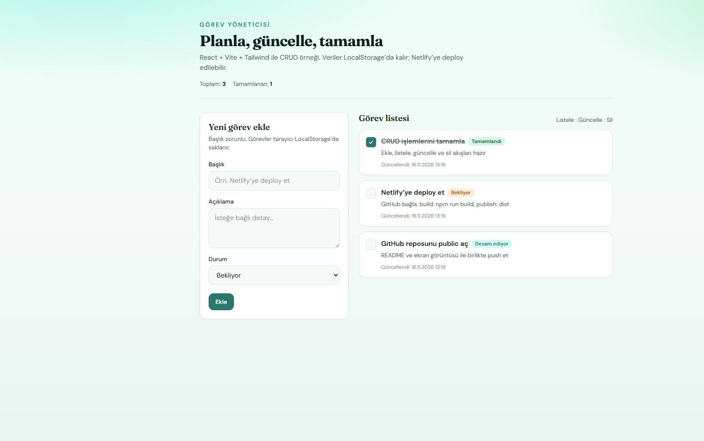

# Görev Yöneticisi

Web Geliştirme / Javascript eğitim projesi.

Bu depo iki parçadan oluşur:

1. **React frontend** — Vite + Tailwind CRUD; veriler tarayıcı LocalStorage içinde saklanır.
2. **Express REST API** (`server/`) — çalışan, proje ve görev takibi; file-based JSON persistence.

## REST API (Express)

Yazılım şirketi senaryosu: görev oluşturma, çalışana atama, durum / öncelik takibi, filtreleme ve temel raporlama.

```bash
cd server
npm install
npm start
```

veya kökten:

```bash
npm run api:install
npm run api
```

API: `http://localhost:3000`  
Dokümantasyon ve örnek istekler: [`server/README.md`](./server/README.md)

### Ana uç noktalar

| Kaynak | Örnek |
| --- | --- |
| Health | `GET /api/health` |
| Çalışanlar | `GET/POST /api/employees` |
| Projeler | `GET/POST /api/projects` |
| Görevler | `GET/POST /api/tasks` |
| Atama | `PATCH /api/tasks/:id/assign` |
| Durum | `PATCH /api/tasks/:id/status` |
| Raporlar | `GET /api/reports/summary` |

## React frontend

```bash
npm install
npm run dev
```

Tarayıcıda: `http://localhost:5173`

### Teknolojiler (frontend)

- **ReactJS** (Vite)
- **Tailwind CSS**
- **LocalStorage**
- Klasör yapısı: `Components`, `Pages`, `Interfaces`

### CRUD işlemleri (frontend)

| İşlem | Nasıl |
| --- | --- |
| Ekle | Formdan başlık (zorunlu) + açıklama + durum ile yeni görev oluşturma |
| Listele | Ana sayfada görev kartlarının listelenmesi |
| Güncelle | “Düzenle” ile formu doldurup kaydetme |
| Sil | “Sil” ile onay sonrası görev silme |

### Ekran görüntüsü



### Production build

```bash
npm run build
npm run preview
```

## Lisans

Eğitim amaçlı örnek proje.
